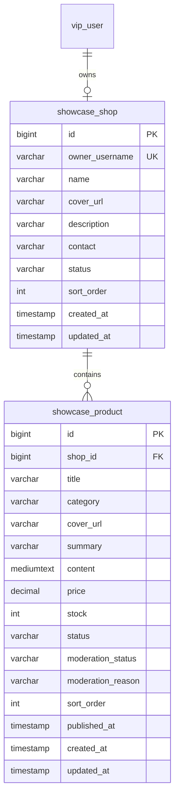

# 用户店铺与商品业务

精品展示已改为：商家列表 → 商家商品列表 → 商品详情。商家管理页以可见状态按钮筛选“系统停用”。用户从“我的店铺与商品”建立自己的店铺并管理商品；后台通过“商家管理”“商品管理”统一维护所有用户数据。

## 业务流程

- 一个有效用户对应一家店铺。首次进入卖家中心填写店铺名称、介绍、封面和自愿公开的联系方式；后续可修改资料。
- 创建店铺后可新增商品，维护名称、分类、封面、简介、详情、价格、库存、排序。商品默认草稿，可自行上架和下架。用户不能转移商品所属店铺。
- 前台先展示正常商家，再展示该商家已上架且未被后台停用的商品；支持搜索、分类和分页。价格以人民币元展示，库存为 0 时显示售罄。
- 后台按账号、店铺、商品关键词查询所有用户的数据，可创建、修改、删除和批量删除；可停用店铺或单个商品。
- 删除非空店铺会被拒绝，需先删除其全部商品，或选择停用。数据库外键也保护此约束。
- 后台停用商品时必须填写500字以内的停用原因，商家列表与编辑页展示“系统停用”和只读原因；支持单独筛选系统停用商品，商家修改资料不能篡改该原因。恢复正常状态后清除当前停用原因，历史操作保留在操作日志。
- 后台停用商品时同步将商品设为下架；商家编辑时禁用“上架”选项，列表统一显示“后台已停用”。后端业务层与 SQL 均拦截停用商品的上架请求。
- 后台停用状态与商家上架状态分离。商家改资料、改商品或伪造状态字段，都不能解除后台停用。后台恢复商品后，仍需满足商家上架状态、店铺正常、账号启用才公开。

本期是商品展示和管理，不包含订单、支付、扣库存及退款。封面填写图片 URL 或站内路径，正文为保留换行的纯文本。

## 表设计

旧版 `showcase_item` 精品内容保留，无商家归属的旧内容不会自动转为商品。原后台入口标记为“精品内容（旧版）”。

用户与店铺通过唯一账号关联，店铺与商品通过数据库外键关联。用户账号删除后的店铺不会被公开（公开查询关联 vip_user，且要求账号启用）。

| 表 | 约束与索引 |
| --- | --- |
| showcase_shop | owner_username 唯一；状态 ACTIVE / BLOCKED；索引 (status, sort_order, id) |
| showcase_product | shop_id 外键，禁止级联删除；状态 DRAFT / PUBLISHED / OFFLINE；后台状态 ACTIVE / BLOCKED；价格 decimal(12,2)，非负且最多2位小数；库存、排序为非负整数；索引 (shop_id, status, moderation_status, sort_order, id) |

字段长度与完整 DDL 见 `manager-service/src/main/resources/db/fa-cloud/showcase-commerce-schema.sql`。

## 接口与权限

以下均为 POST，经过已有网关认证。用户接口不接收客户端指定的账号作为身份：以可信网关头 X-User-Name 为准，操作前校验账号启用。更新/删除 SQL 同时限定商品 ID 和店铺所属账号，防止越权。后台四类权限沿用 partner:showcase:view/add/edit/delete，服务端方法权限检查与前端按钮权限保持一致。

| 用户接口（前缀 /api/users/commerce） | 说明 |
| --- | --- |
| /shops/page | 商家分页，keyword/pageNum/pageSize |
| /shops/{id} | 商家公开资料 |
| /shops/{id}/products/page | 指定商家商品分页，支持 keyword/category/pageNum/pageSize |
| /shops/{id}/categories | 该商家已公开商品分类 |
| /products/detail/{id} | 商品详情；不可公开时返回业务错误码40400 |
| /mine/shop | 当前用户店铺，无店铺时 data=null |
| /mine/shop/save | 创建或修改自己的店铺资料，不接受后台状态和排序 |
| /mine/products/page | 自己的商品列表，包含草稿、下架、停用商品，支持 keyword/status/pageNum/pageSize |
| /mine/products | 新增，所属店铺由登录用户确定 |
| /mine/products/update/{id} | 修改自己的商品；忽略 shopId、ownerUsername、moderationStatus 等归属/后台字段 |
| /mine/products/delete/{id} | 删除自己的商品 |

后台接口沿用 `/api/manager/partner/features/{feature}`，feature 为 commerce-shops 或 commerce-products：`/page`、新增根路径、`/update/{id}`、`/delete/{id}`。列表请求使用表单参数，写入请求使用 JSON。商品后台按 shopId 关联店铺，编辑不允许改变店铺；店铺编辑不允许改变所属用户。写操作记录现有操作日志。批量删除复用现有逐项删除与结果汇总。

用户服务沿用项目现有 ApiResponse 约定：业务失败的 HTTP 状态可能是200，应同时判断 code；后台业务失败使用对应 HTTP 状态。前端已有 apiClient 处理业务码。

## 安装与启用

已有精品模块的环境依次执行：

1. `manager-service/src/main/resources/db/fa-cloud/showcase-commerce-schema.sql`
2. `manager-service/src/main/resources/db/fa-cloud/showcase-commerce-menu.sql`
3. 已有商品环境执行 `manager-service/src/main/resources/db/fa-cloud/showcase-commerce-blocked-offline.sql`，将历史停用且显示上架的商品同步下架。
4. 已有商品环境执行 `manager-service/src/main/resources/db/fa-cloud/showcase-commerce-moderation-reason.sql` 添加原因字段，历史停用记录显示“具体原因请联系管理员”。

新环境先执行旧有 showcase-schema.sql、showcase-menu.sql 初始化基础权限，再执行以上脚本。脚本可重复执行。商家/商品菜单与按钮默认授予现有 SUPER_ADMIN、MANAGER；其他角色通过角色管理配置。需要单独补超级管理员授权时执行 showcase-super-admin.sql。

本地 fa-cloud 已创建两张表并初始化菜单。重启 partner-service、manager-service，更新两端前端；后台重新登录或刷新菜单后使用。无需修改 auth-service 的数据库连接或网关路由。

## 测试

- frontend / mobile-frontend：`npm run build`。
- `mvn -pl manager-service,partner-service -am test`：包括金额、库存、字段白名单、归属绑定、缺失账号、不可见资源、分页和后台权限测试。
- `scripts/test-commerce-api.py`：使用两个新建且没有店铺的开发测试账号，验证真实本地服务的商家创建、草稿隐藏、发布浏览、搜索分类分页、跨用户越权拒绝、金额库存校验、后台全用户查询、权限拒绝、商品停用、店铺停用、恢复和删除。
- HTTP 用例通过测试专用端口的可信网关请求头模拟已认证身份；不替代网关 JWT 登录流程测试。运行需设置 COMMERCE_TEST_USER_A/B（账号前缀必须为 __commerce_test_），可设置 PARTNER_TEST_URL / MANAGER_TEST_URL / COMMERCE_INTERNAL_TOKEN。
- 脚本只对新建测试店铺执行清理，不操作已有商家。账号准备与账号清理单独执行。

浏览器自动化受当前工具环境错误影响，尚未完成页面点击回归；已完成两端构建和真实 HTTP 业务链路验证。
